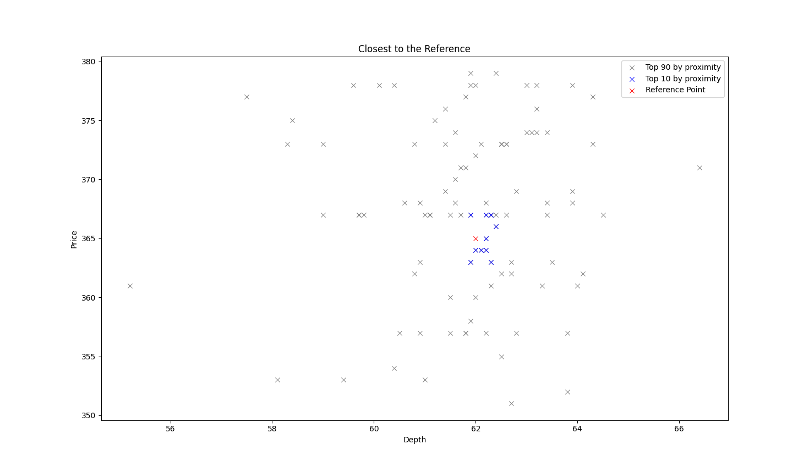

# BestMatch (MA52109 – Computational Lab 02 submission)
## Introduction

BestMatch is a Python package that can find the closest match from a dataset given a set of continuous/numerical search parameters. It does not consider each parameter in isolation, but together, in order to generate search results with the most relevance to the query. It can also plot these matches on a graph, highlighting the top results.

## Installation

From inside the root directory, install the package in editable mode:

```sh
python pip install -e .
```

## Main Functionality
### BestMatch.search

- `csv_to_dict_list(location)` accepts a CSV file location and returns a list of dictionaries, where key names match the column headers in the CSV file. Each dictionary is like a row in a table.

- `extract_date_add_year(dict_list, column)` accepts a list of dictionaries (`dict_list`) with a date parameter (`column`), formatted as either DD/MM/YYYY or MM/DD/YYYY. It extracts the year as an integer and places it in a new column, `year`. This is useful for processing untidy data prior to commencing a search.

- `find_relevant(dict_ref, dict_list_all, top_n)` accepts a reference set of parameters presented as a dictionary (`dict_ref`), with key names in common with a target dataset (`dict_list_all`). The proximity between the reference attributes and target attributes is calculated, the closest `top_n` results are then returned as a list of dictionaries (i.e. a list of 'rows'). Can be used with any number of attributes (so you can take any number of parameters into consideration at once).

### BestMatch.plot

- `plot_best(dict_list, dict_list_ref, keys, n)` accepts a list of two key names (`keys`), and plots their values from `dict_list`. The reference attributes are also plotted via `dict_list_ref` to better understand proximity. The `n` closest values are highlighted differently to the rest of the plotted points.

## Example Plot

Here is the plot from `demo/diamonds.py`:




## Example Code

From `demo/diamonds.py`:

```python
import BestMatch as bm

# Convert CSV file detailing diamonds into a list of dictionaries.
diamond_list = bm.csv_to_dict_list('data/diamonds.csv')

# Define a search term.
reference = {'depth': 62, 'price': 365}

# Return top 100 search results.
relevant = bm.find_relevant(reference, diamond_list, 100)

# Plot the reference point and the top 100 search results, highlighting the top 10.
fig, ax = bm.plot_best(relevant, reference, ['depth', 'price'], 10)
bm.show()
```
